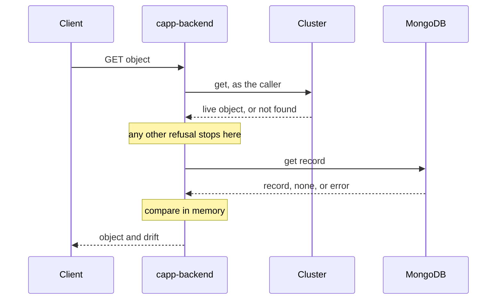
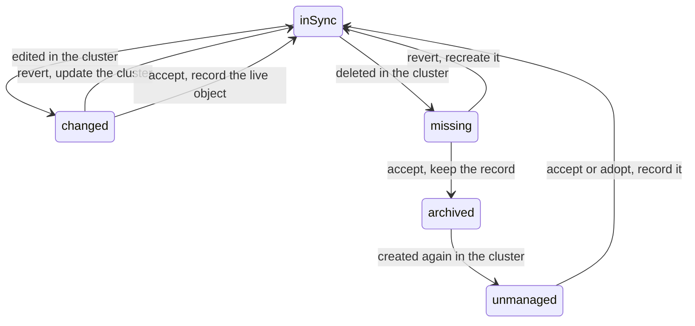
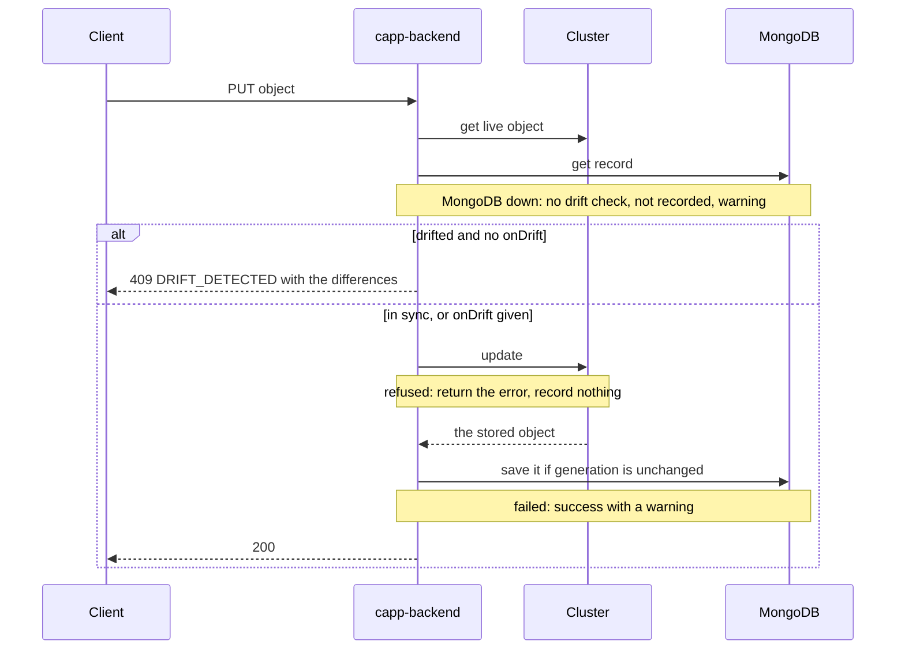

# Desired state: design and decisions

How the desired state feature works and why. For running it, see
[desired-state.md](desired-state.md).

## The problem

Git sync was the only copy of state outside the cluster. Each change to a synced Capp was
a commit and a push, so Git was used as a database. It covered Capps only, one by one, and it
could not tell whether a cluster still matched the repository.

Now MongoDB holds the desired state of every managed Capp, ConfigMap, Secret and namespace.
Drift is the difference between that record and the live object.

## Flow

### Read



MongoDB is asked only after the cluster answered the caller's own read. The cluster's access
rules therefore also cover the desired state. If MongoDB is down, the object is still returned
with state `unavailable`.

### Decide



Nothing moves between these states without a request. Revert and accept send back the
`generation` and `liveVersion` the caller saw. If either changed, they answer 409.

### Update



With `onDrift=accept` the update starts from the live object, with `onDrift=revert` from the
record. Fields in the request win in both cases.

## Decisions

### Drift is computed on read. There is no reconciler and no cron

A person decides about drift, so it only has to be known when somebody looks. Comparing on read
needs no second process, no watches on every cluster, no leader election, and cannot act on
its own.

*Cost:* drift that nobody reads is not noticed. Alerts or automatic revert would need a
reconciler, which could be added later on the same records.

### The cluster is written before MongoDB, without a transaction

A MongoDB transaction cannot include Kubernetes. `WithTransaction` may run its callback again
after a transient error, which would repeat the cluster write, and aborting it would not undo
that write. Writing MongoDB first would record states the cluster then refuses.

So the order is: read the record, write the cluster, record what the cluster returned.

- A refused write is never recorded.
- Defaults set by the API server or a webhook are part of the returned object, so they are not
  drift.
- The only gap is MongoDB failing before or between the two. The response carries a
  `DESIRED_STATE_FAILED` warning and a later read shows drift.

Saving does not depend on the request staying open. Each save is one document guarded by
`generation`, so a standalone MongoDB server is enough. If another request saved in between, the
backend records what is live, because saves can arrive in a different order than the cluster
writes.

### The backup never blocks a change

MongoDB holds a backup, so its failure must not stop anyone from deploying. When it cannot be
used, reads report `unavailable` and writes go ahead with a warning. Only requests that are about
the record itself answer 503: revert, accept, adopt and `onDrift=revert`. Not having MongoDB at all
is the same as turning the feature off.

A write that could not read the record is not saved either, even if MongoDB is back by then. Its
drift was not checked, and saving the result would turn somebody's manual edit into the desired
state without anyone deciding. The same holds for a record that cannot be decrypted: it is kept,
because it is readable again once its key is back.

*Cost:* after an outage, changes made through the API show as drift until somebody accepts them.

An unreachable MongoDB is left alone for 10 seconds (`desiredstate.WithCooldown`). Otherwise every
request of an outage would wait for the timeout, and a migration once per object.

### Accepting has no permission check of its own

Accept and adopt change only MongoDB, and having a backup is never harmful. Whoever may read an
object may accept it. In backend-policy mode that includes viewers, and
`TestNewPolicyRouteCoverage` has an explicit exception for these routes.

*Cost:* accepting replaces the recorded state and keeps no history, so a viewer can make a manual
edit the new desired state. `updatedBy` records who did, when the username is known.

Revert changes the cluster. It uses the caller's credential and needs the permission of the
equivalent update.

### Accepting a missing object archives its record

The record stays as a backup and is no longer reported. Deleting an object through the API
removes its record, because that is an explicit decision to drop it.

### Resources carry no document id

The record id is `cluster/Kind/namespace/name`, so it is already known from the request and a
lookup uses the primary key. An annotation would add a write per object, could be edited or copied
to another object, and is lost when an object is deleted, which is when a lookup matters most.

### Updating a drifted object needs a choice

An update starts from the live object and copies the fields the API does not manage. Saving the
result would accept somebody's manual edit without anyone deciding. So `PUT`, namespace `PATCH`
and removing a rollout strategy answer 409 unless `?onDrift=accept|revert` is sent. A rollback
replaces the whole spec, so it does not ask.

A namespace `PATCH` with `onDrift=revert` also needs the permission of `PUT`, because it resets
the quota and removes users. Without that, anyone who may create Capps could do both.

### Reverting an unmanaged object is not offered

It would mean deleting the object. An object without a record may predate the feature.

### One collection, and clusters stay in YAML

All kinds share `objects`: they have the same identity, guard and lifecycle, and are always queried
by cluster, kind and namespace. What a namespace may use and who may use it is a record of kind
`Namespace`. Clusters stay in YAML because the backend must start while MongoDB is down, and
because their credentials do not belong in it.

### Git sync is removed, not kept as an option

Two backups with different coverage would leave it unclear which one to trust, and an Argo CD
Application on the old repository undoes every revert. An old configuration still works: its Git
sync settings are ignored, with a warning when `gitops.enabled` is true.

*Cost:* an upgrade that does not enable desired state ends the backups, and only the warning says
so.

`go-git` remains a dependency: cfunc functions read their code with it.

## Schema

Collection `objects`, with an index on cluster, kind and namespace:

```
_id          "cluster/Kind/namespace/name"
cluster, kind, namespace, name
desired
  projectorVersion
  json         the projection, as JSON text
  secretData   [{ key, keyId, nonce, ciphertext }]
generation   +1 per write, guards concurrent writes
archivedAt   set when a missing object was accepted
source       write | accept
updatedBy, updatedAt
```

A namespace uses its own name as `namespace` too, so one filter finds everything in it.

## Things to know before changing it

- **Compare projections, not objects.** `StateOf` in `internal/desiredstate/state.go` keeps the
  fields users own. A field the operator writes must be dropped there, or it is permanent false
  drift.
- **The projection is JSON text.** BSON loses `resource.Quantity`, which keeps its amount in
  unexported fields, and keys such as `tls.crt` contain dots.
- **Labels and annotations count only for recorded keys,** because controllers add their own.
- **`liveVersion` is a keyed hash of the projection.** `resourceVersion` changes with every status
  update, and a plain hash would let a reader guess Secret values. Rotating the encryption key
  changes it.
- **Secret values are bound to their object and data key** (AES-256-GCM additional data), so they
  cannot be moved between documents. Drift lists paths only.
- **`missing` can leak names.** A list across namespaces in backend-policy mode must ask only for
  `policy.AggregateNamespaces`.
- **Namespaces are compared on single reads only.** Their list reads ignore quota and RoleBinding
  errors, which would look like drift.
- **Every handler that writes a tracked kind must record it,** unless it changes only fields the
  projection drops, such as a rollout action.

### Adding a kind

1. Add its projection to `StateOf` and `Apply`, and cover both in `state_test.go`.
2. In the handler, use `Begin` (which never fails a request), `ResolveDrift` on updates, and `Save` or `Delete` around every
   write, and `Inspect` or `InspectList` on reads.
3. Register `tracking.Actions`, and add the kind to `adoptedKinds` in `cmd/server/main.go`.
4. Declare the routes in `internal/middleware/policy/routes.go` and `api/openapi.yaml`.

## Known limits

- No history, no alerts, no automatic revert.
- cfunc pools and functions are not tracked.
- Not yet run against a real API server with the operator's defaults and webhook. Handler tests
  use a fake client, which has neither.
