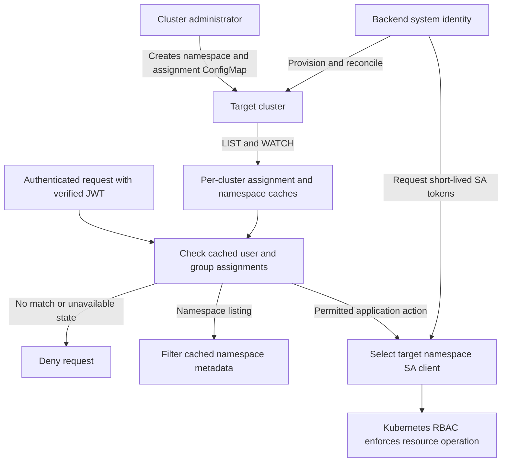

# Service account based authorization proposal

**Purpose:** Describe an independent authorization alternative using operator-managed assignments and namespace-scoped service accounts, and explain the case for adopting it.

**Status:** Design proposal for team review. The choices below were agreed during design discussion; adoption and implementation are not approved by this document. Existing requirements, HLD, LLD, and implementation plans remain unchanged.

## Recommendation

Adopt this direction if the team accepts operator-only namespace and membership administration and the remaining feature-permission mappings can preserve reviewed access. Use Kubernetes RBAC for resource enforcement, while capp-backend checks user assignments and application-specific actions.

The main benefit is a simpler permission model: one existing `capp-user` role, one assignment ConfigMap per target namespace, and one restricted execution SA per target namespace. Operators manage assignments directly; the backend no longer needs a user-facing membership editor or a general resource-permission evaluator. This is a stronger simplification than merely replacing Casbin while retaining all existing policy flexibility.

The tradeoff is explicit: the backend takes responsibility for provisioning SAs and bindings, renewing credentials, and reconciling state. Reduced total code size and improved latency are expected possibilities, not validated benefits or adoption guarantees.

## Scope and agreed decisions

| Concern | Proposed behavior |
|---|---|
| Authentication | Reuse existing verified JWT identities and groups; initially retain the LDAP scope of the new authorization mode. |
| Roles | Start with `capp-user` only, using the Helm role as the permission reference. Add roles only for a demonstrated need. Future multiple roles would form a fixed cumulative hierarchy; the highest matching assignment wins. |
| Assignments | Exactly one predictably named ConfigMap per target namespace, containing user/group-to-role assignments, not resource permission definitions. |
| Placement | Assignment ConfigMaps and execution SAs live in a protected namespace on each target cluster. |
| Execution identity | One `capp-user` SA per target namespace, shared by authorized users of that namespace. No end-user impersonation and no SA credentials delivered to users. |
| Namespace lifecycle | Operators create/delete target namespaces and manage quotas. Users manage permitted resources inside them. |
| Membership administration | Operators edit ConfigMaps through Kubernetes. Membership-editing APIs are unavailable in this mode. |
| Provisioning | Capp-backend creates and maintains the required SAs and RoleBindings, and repairs changes to its managed objects. |
| Namespace visibility | Return only assigned namespaces whose execution SA and binding are ready. |
| Adoption | Opt-in, with existing modes remaining the default and supported. No automatic fallback between authorization modes. |

## Architecture and responsibility

Each target cluster holds its own assignments, SAs, and bindings. Backend replicas use equivalent configuration and independently maintain caches and credentials; users do not require sticky sessions. Permission changes are eventually consistent across replicas.

The backend system identity reads policy and namespace metadata, records namespace identity, provisions managed objects, and requests execution tokens. It is not a fallback identity for denied or unready user resource operations. Give it the required explicit permissions rather than treating “system identity” as a requirement for `cluster-admin`.

Execution SAs live outside user workload namespaces. Each target namespace has a RoleBinding referencing its corresponding protected SA and the shared `capp-user` ClusterRole. Reusing a ClusterRole definition does not require sharing one execution SA across namespaces. This provides a Kubernetes namespace boundary in addition to backend assignment checks.

## Policy and request flow

Operators specify the target namespace name and user/group assignments. The precise ConfigMap name, schema, labels, and annotation keys remain implementation-design details; there must be one unambiguous policy object for each target namespace.

Policy loading validates structure and supported roles. It does not query LDAP to verify that each named user/group exists. Request authentication verifies the JWT and supplies trusted identities; matching follows existing username/group semantics. Unknown identities simply do not match until presented by an authenticated caller. JWT-carried groups retain their existing expiry/refresh behavior.

For an ordinary resource request:

1. Verify the caller and resolve the target cluster and namespace.
2. Check valid cached assignments, namespace identity, configured restrictions, and provisioning readiness.
3. Require a matching user or group assignment; otherwise deny.
4. Perform any required application-action check, then select that namespace's SA client.
5. Execute the resource operation; Kubernetes enforces the SA's RBAC permissions.

Possession of a cached SA token is never evidence that a caller remains assigned. Check assignments on every request. Keep the verified caller in audit records: the shared namespace SA identifies an execution role, not the person who initiated the request. Do not log tokens or Secret contents.

## Namespace listing and scale

Namespace listing uses cached assignments and cached namespace metadata maintained by the system identity. Alice assigned to ten ready namespaces sees those ten namespaces; the backend does not issue ten SA requests or ten permission-review requests. Filter before computing totals or exposing details and capabilities. Preserve configured namespace restrictions and protected-namespace exclusions.

Maintain indexes from users/groups to namespace assignments. Use collection LIST/WATCH per target cluster and replica, not one watch per policy object. Process an assignment change for the affected namespace rather than reloading all policies. Namespace metadata and provisioning readiness also need cached observation.

For `N` managed namespaces and one role, expect roughly `N` assignment ConfigMaps, `N` execution SAs, and `N` RoleBindings, plus shared role definitions and the system identity. Object counts grow with namespaces rather than users. Memory and initial loading grow with assignment payloads and indexes; replica count multiplies cache and watch costs. Quotas or other live details may still require data reads even when authorization and metadata need none.

This is a reasonable design to evaluate at thousands of namespaces, not a measured capacity claim. Test realistic membership counts, initial loads, update bursts, recovery, and token renewals. Each ConfigMap's data is limited to 1 MiB; very large memberships require a separately reviewed strategy. See [ConfigMap limits](https://kubernetes.io/docs/concepts/configuration/configmap/) and [Kubernetes LIST/WATCH](https://kubernetes.io/docs/reference/using-api/api-concepts/#efficient-detection-of-changes).

## Provisioning and credentials

A valid assignment ConfigMap triggers reconciliation of the namespace's SA and RoleBinding. Publish readiness only after the required objects and their intended permissions are established. Until then, hide the namespace from user discovery and deny resource operations. Retry failed provisioning without requiring an operator to edit policy again.

Reconciliation must be idempotent across replicas and repair drift in backend-owned SAs and bindings. Never adopt, overwrite, or delete unrelated objects merely because their names collide. Operators change assignments through policy rather than manually editing generated bindings. Ownership tracking, concurrent updates, and how readiness reacts to observed drift need explicit implementation treatment.

Request short-lived tokens using Kubernetes TokenRequest. Cache credentials per target SA, acquire them on demand, and renew before expiry without issuing a token per user request. Keep credentials internal and bounded in memory. If no usable token is available, fail the operation; never substitute the system identity. Renewal failures can use an otherwise valid token until expiry, but cannot extend its lifetime. See [service-account token guidance](https://kubernetes.io/docs/reference/access-authn-authz/service-accounts-admin/#manual-secret-management-for-serviceaccounts).

The system identity needs sufficient RBAC authority to create bindings and request tokens. Kubernetes binding/escalation restrictions must be accounted for with explicitly scoped privileges. Execution SAs must not access protected policy, backend credentials, or provisioning APIs. User workloads must not be able to select the protected SAs. See [RBAC restrictions](https://kubernetes.io/docs/reference/access-authn-authz/rbac/#restrictions-on-role-binding-creation-or-update) and [workload creation risks](https://kubernetes.io/docs/concepts/security/rbac-good-practices/#workload-creation).

## Namespace identity and failure behavior

Operators do not copy namespace UIDs manually. When first accepting a policy, capp-backend persists the target namespace UID in a dedicated ConfigMap annotation, without changing operator-owned assignments. Persist this association before activating access. Concurrent replicas must not overwrite an existing association or silently rebind it after a restart.

If a namespace is recreated with the same name, the recorded UID no longer matches. Deny access once the replacement is observed and retire obsolete managed objects. To intentionally grant access to the replacement, the operator deletes and recreates the policy ConfigMap. Distinguish the old and new policy objects during asynchronous cleanup so old work cannot delete replacement resources.

| Situation | Behavior |
|---|---|
| Initial policy/namespace load incomplete | Deny access. |
| Valid policy but provisioning incomplete | Hide namespace; deny operations; retry provisioning. |
| No matching user/group assignment | Deny access. |
| Confirmed deleted or invalid policy | Deny that target namespace once observed; other namespace policies remain independent. |
| Deleted policy | Also remove only the backend-owned execution SA and binding; never delete the target namespace. |
| Temporary watch/read failure | Continue using last valid cached assignments and metadata; retry recovery and expose failures. |
| Observed namespace UID mismatch | Deny access; require explicit policy recreation to restore it. |
| Missing/expired token without successful renewal | Fail operation without privileged fallback. |

There is no agreed fixed revocation deadline. Removed access can remain usable until caches observe the change; the same applies to detecting namespace recreation and managed-object drift. Already-authorized operations may finish. No claim of immediate isolation across namespace recreation follows from UID tracking alone. Policy deletion triggers cleanup; malformed policy denies access but does not by itself authorize destructive cleanup.

## Existing features and additive migration

Keep Git sync, migration, and benchmarks available only where reviewed existing access can be preserved. Do not assume that every existing `capp-user` may perform all three.

- **Git sync:** authorize the application action before any Git side effect. Kubernetes cannot enforce Git access. The existing handler writes Git before its Kubernetes patch; see [sync handler](../../../../internal/resources/namespaced/capps/handler.go).
- **Migration:** authorize source and destination assignments and required operation permissions before dependent reads/writes. Use the corresponding execution identity at each end. Fixed role names are insufficient if their effective definitions can drift independently.
- **Benchmarks:** preserve existing eligibility and map the required resource operations explicitly. The current `capp-user` chart role does not grant batch Job permissions; enabling benchmark access requires a reviewed mapping rather than automatic broadening.
- **Namespace administration:** creation, deletion, quota changes, and membership edits become operator-only in this mode. These endpoints must not continue executing through privileged credentials on behalf of users.

These are intentional changes to the current design, especially its editable membership requirement. They must be reconciled with [authorization requirements](requirements.md#r02) and [shared additive compatibility](../requirements.md#r02) before adoption. Deployments needing the old administration behavior remain on legacy mode until an explicit migration agreement exists.

## Comparison with the current approach

| Area | Current design | This proposal |
|---|---|---|
| Resource enforcement | Casbin evaluates caller/resource/action; a shared backend client executes approved operations. | Backend checks assignment; namespace SA's Kubernetes RBAC enforces resource operations. |
| Policy flexibility | ConfigMaps define roles, resource actions, and scoped user/group grants. | ConfigMaps contain assignments to a fixed role; Kubernetes defines resource permissions. |
| Execution identities | One reusable backend service client per cluster/replica. | System identity plus one execution SA per target namespace, with token management. |
| Membership editing | Authorized application users can edit membership through API flows. | Operators edit ConfigMaps directly; no membership-editing API in this mode. |
| Namespace listing | Cached metadata with application permission evaluation. | Cached metadata filtered by assignments and provisioning readiness. |
| Work that remains | Authentication, caches, restrictions, auditing, feature checks, migration validation. | Same responsibilities, with simpler assignment checks and additional reconciliation. |

Current-design references: [HLD architecture](hld.md#architecture), [LLD policy and permissions](phase-3/lld.md#policy-and-permissions), and [Helm capp-user role](../../../../helm/capp-backend/templates/capp-user-cr.yaml). The comparison was reviewed against checkout `508c504e11fbc914562a4ea75b0c9cdd26dca923` and its working-tree namespace-mutation/cache changes. The new proposal is not implemented or runtime-validated.

### Advantages

- Reuses Kubernetes resource enforcement and the existing application role instead of maintaining general resource-policy evaluation in the backend.
- Operator-only assignments remove application membership delegation and editing flows from the new mode.
- Namespace-specific credentials constrain resource access even after backend client selection.
- ConfigMaps provide familiar, reviewable administration without another policy database or service.
- Standard Kubernetes APIs make authorization independent of OpenShift user identities; user credentials never leave the backend authentication flow.

### Costs and limitations

- Provisioning, cleanup, drift repair, and token renewal become backend responsibilities.
- Application actions and filtered discovery still require backend checks; this is not “RBAC handles everything.”
- Fixed roles offer less flexibility than arbitrary resource/action grants. One `capp-user` role may not express every existing restriction or benchmark entitlement.
- The Helm reference grants broad access, including Secrets and Pod operations. It is a starting point for review, not proof that every permission is required. Namespace entries in a ClusterRole bound through a namespaced RoleBinding do not grant cluster-scoped Namespace access.
- Eventual consistency can delay revocation, and namespace/assignment counts affect recovery, memory, and token traffic.

## Adoption review still required

1. Confirm the exact `capp-user` rules, application-action eligibility, and treatment of existing custom/group/global grants. Identify permissions that cannot be preserved with one fixed role rather than broadening them silently.
2. Specify the policy schema, UID annotation lifecycle, ownership/readiness rules, and multi-replica reconciliation safeguards without making operators manage UIDs.
3. Validate access equivalence, denied paths, credential isolation, provisioning/renewal failures, namespace recreation, and expected load. Existing Casbin measurements do not validate this alternative.
4. Agree migration and rollback behavior, including how policy edits made in the new mode translate back to legacy access. Then update the existing design documents together, rather than treating this independent proposal as their replacement.

The adoption case is a narrower, operator-managed authorization model aligned with Kubernetes enforcement. It should be accepted for that operational fit, not on an unsupported promise of drastic line-count savings.
