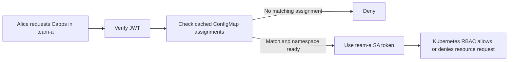

# Service account authorization team review

**Purpose:** Explain the proposed authorization flow and adoption tradeoff for a quick team review.

**Status:** Proposal, not implemented. [Full design and open review items](sa-rbac-design.md).

## The idea

Use Kubernetes RBAC to enforce resource permissions. Capp-backend checks **who may use a namespace**, then uses that namespace's service account (SA) for resource requests.

Start with the existing `capp-user` role. Users receive no Kubernetes credentials. The new mode is opt-in; legacy behavior stays available.

## Example with Alice and team-a

Operators create namespace `team-a` and a policy ConfigMap assigning Alice and group `developers` to `capp-user`. The ConfigMap contains assignments only; Kubernetes Roles define resource permissions.

Names below are illustrative, not a finalized naming convention.

| Object | Location | Who manages it |
|---|---|---|
| Namespace `team-a` | Target cluster | Operators |
| ConfigMap `access-team-a`: Alice/developers → `capp-user` | Protected backend namespace | Operators edit assignments |
| SA `team-a-capp-user` | Protected backend namespace | Capp-backend |
| RoleBinding: `capp-user` → that SA | Inside `team-a` | Capp-backend |

Capp-backend records the target namespace UID on the ConfigMap automatically and provisions the SA/binding before enabling access. All assigned users share this namespace's SA; another namespace gets its own SA.

The backend obtains and renews short-lived SA tokens internally. Its separate system identity manages caches and provisioning; it never substitutes for a denied or unready user request. Caller auditing still records Alice.

## Namespace listing and changes

- Alice assigned to ten ready namespaces sees those ten. Listing uses cached assignments and namespace metadata, without ten SA calls or permission-review requests. Additional details such as quotas may still require data reads.
- Collection watches update the caches. More namespaces mean more objects and memory, not a policy read per user request. Capacity still needs testing.
- Deleted or invalid policy denies that namespace once observed. During connection failures, last valid cached assignments remain usable, so revocation can be delayed.
- Deleting policy also cleans up its managed SA/binding. Recreating a namespace requires recreating its policy to restore access; operators do not copy UIDs manually.

## What changes

| Current design | Proposed approach |
|---|---|
| Casbin evaluates resource permissions before a shared backend client executes. | Backend checks assignments; a namespace SA's Kubernetes RBAC enforces resources. |
| ConfigMaps define flexible permissions and assignments. | ConfigMaps assign users/groups to the fixed `capp-user` role. |
| Authorized users can edit memberships through the API. | Operators alone edit memberships, create/delete namespaces, and change quotas. |

**Benefits:** a narrower permission model, fewer application permission/delegation rules, familiar operator-managed ConfigMaps, and namespace-restricted execution credentials.

**Costs:** SA/binding reconciliation and token renewal; less policy flexibility; eventual consistency. Git sync, migration, and benchmarks still need backend checks and reviewed permission mappings. Kubernetes does not authorize Git side effects.

## Recommendation for the team

Adopt if operator-only administration and the single-role model fit our needs, and existing feature access can be preserved. The justification is simpler responsibilities and standard resource enforcement—not a promised large code reduction.

Before committing, review feature permissions, migration/rollback, and failure/load validation. See the [full comparison](sa-rbac-design.md#comparison-with-the-current-approach) and [remaining adoption review](sa-rbac-design.md#adoption-review-still-required). Existing design documents remain unchanged until adoption is agreed.
